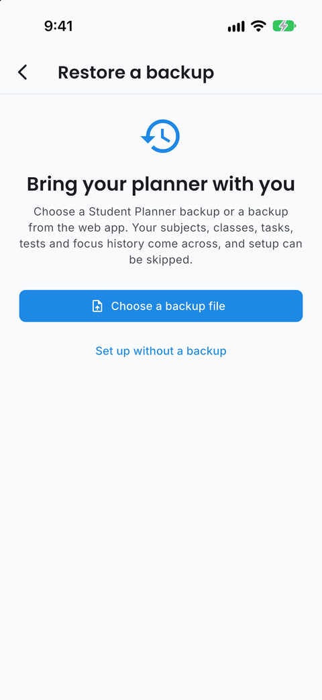

# Export and import

A backup is a single file with all your planner data: semesters, subjects, classes, tasks, tests,
topics, attendance and focus history. Make one before you change devices, clear the app's data, or
replace what you have. Guest data has no other copy.

## Export everything

1. Open **Settings → Your data**.
2. Choose **Export everything** and save the file somewhere safe.

The backup is a dated JSON file. It works offline and in guest mode. It never contains your
password or any kept university login, but it does contain your study records, so keep it private.

## Restore from a backup

1. Open **Settings → Your data** and choose **Restore from a backup**.
2. Pick the file. Backups from this app and from the old web app both work.
3. Choose how to apply it:
    - **Merge** keeps what you have and adds or updates what's in the file.
    - **Replace** deletes your current planner data first, then restores the file. It asks you to
      confirm, because it can't be undone.

Restoring brings back your planner data, not your sign-in. Sign in separately if you want it synced.

## Restore on a new device

On a fresh install you can restore before setting anything up:

1. On the welcome screen, choose **Restore a backup**.
2. Choose **Choose a backup file** and pick it. On iPhone and iPad, it can be in Files, iCloud Drive
   or **On My iPhone**.
3. The app says how many records will be added; choose **Restore**.

Setup is then skipped and you land on your Dashboard as a guest, with everything from the backup.
Create an account afterwards from **Settings → Account** if you want it synced.

{ width="260" }

**Set up without a backup** goes back to the normal [setup](../getting-started/onboarding.md).

## Move to another device

- **With an account:** sign in on the new device. Everything comes down from your account.
- **As a guest:** export a backup, move the file to the new device (by AirDrop, email to yourself or
  a cloud drive), and restore it there. Or create an account on the old device first, then sign in
  on the new one.

## Import a timetable

To add classes rather than a whole planner, use the Planner's menu:
[Import from your university](../features/university-import.md) or
[Paste a timetable](../features/schedule.md#paste-a-timetable).
