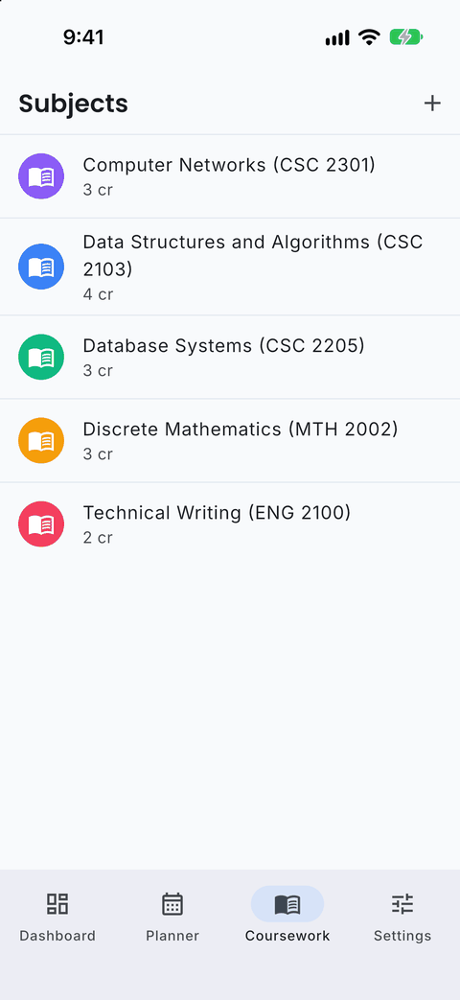
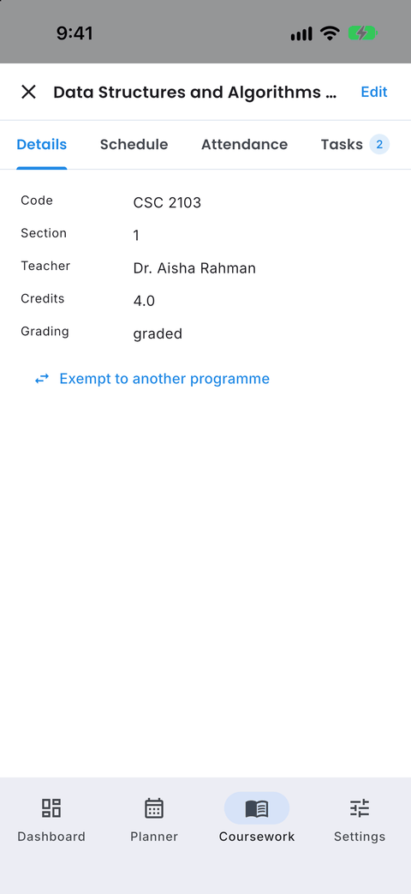
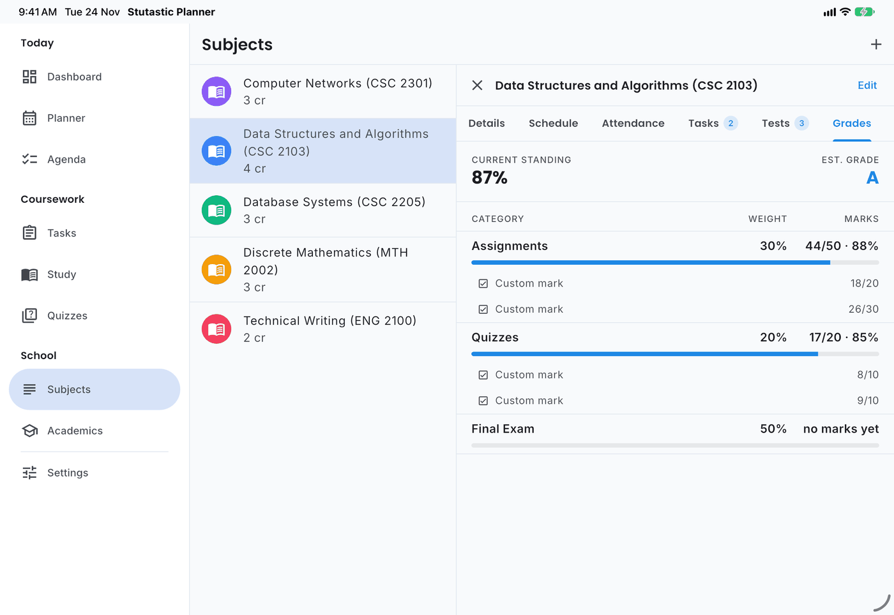
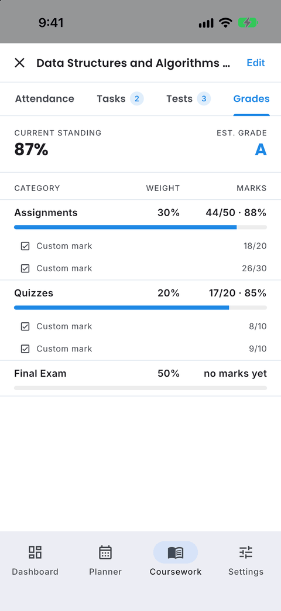
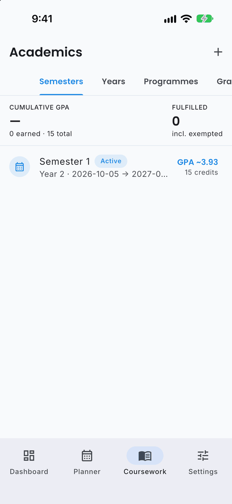
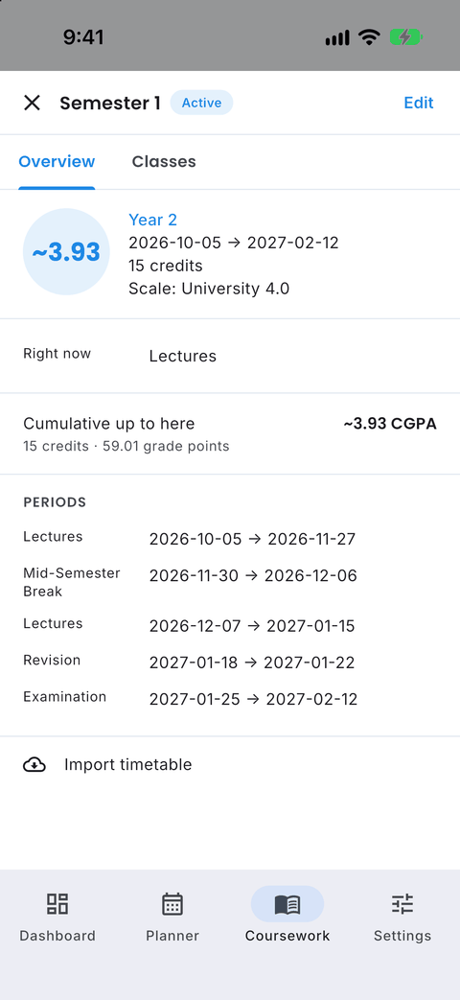

# Subjects and academics

Your **programme** holds **years**, the years hold **semesters**, and each semester holds the
**subjects** you take in it. Everything else in the app belongs to a subject, and your grades roll up
into a semester GPA and a CGPA.

## Subjects

Open **Subjects** to see this semester's subjects with their codes and credits. Tap one to open it.

{ width="240" }
{ width="240" }

A subject has six tabs:

| Tab | Shows |
|---|---|
| **Details** | Code, section, teacher, credits and how it's graded |
| **Schedule** | Its weekly classes |
| **Attendance** | How much you've missed, and every class so far with its mark. See [Attendance](attendance.md) |
| **Tasks** | Its tasks, with the number still open on the tab |
| **Tests** | Its quizzes, tests and exams |
| **Grades** | Your marks so far, your standing and the grade you're heading for |

On a tablet in landscape or a large window, the subject opens beside the list.

### Add or edit a subject

Tap **+** on **Subjects**, or open a subject and choose **Edit**. Enter:

- **Subject name** and **Code**, such as "Data Structures and Algorithms" and "CSC 2103";
- **Credits**, which weight the subject in your GPA;
- **Grading**: **Graded** for a letter grade that counts toward your GPA, or **Pass / Fail**,
  **Audit** or **Exempted** for one that doesn't;
- **Final grade**, once you have it;
- optionally the **Teacher** and **Section**, and your own **Warn at %** and **Barred at %** lines
  for [attendance](attendance.md#the-warning-and-barring-lines).

Turn on **Archived** to hide a subject from the list while keeping its grade.

## Marks and grades

The **Grades** tab works out where you stand before the final grade is in. Set it up once per
subject, from **Edit → Grades**:

1. **Add category** for each part of the assessment, such as Assignments, Quizzes and Final Exam,
   with its **Weight (%)**, its share of the final grade. The weights should add up to 100.
2. In each category, **Add mark** for each piece of work. Link a **Quiz** or **Task** to read its
   score from there, or choose **Custom** and type the **Score** and what it's **Out of**.

{ width="260" }

The tab then shows your **Current standing**, a percentage of the marks given so far, and the
**Est. grade** it would earn on your grading scale. Categories with nothing in them yet, such as a
final exam still to come, show **no marks yet** and don't count against you.

When the subject's final grade is set, its final exam's score is worked out from it.

## Academics

**Academics** has four tabs: **Semesters**, **Years**, **Programmes** and **Grading**. The top shows
your **Cumulative GPA** and the credits you've **Fulfilled**.

{ width="240" }
{ width="240" }

### Semesters and periods

Open a semester for two tabs:

- **Overview**: its GPA, its credits and grading scale, **Right now** (which period you're in), the
  **Cumulative up to here** CGPA, and every period in the term.
- **Classes**: each subject in it with its credits and grade.

Choose **Edit** to change it, in two parts: **Details** (name, dates and grading) and **Periods**.

A semester's **periods** divide it up: lectures, break, revision, exam, holiday, or a **custom**
period with your own name, such as an orientation week, and its own "classes run" and "counts as a
teaching week" switches. Periods:

- number the teaching weeks in the Planner;
- stop classes on days in a break, exam or holiday period, and tint those days in the month view;
- set the Week A anchor date for [alternating classes](schedule.md#alternating-weeks).

A new period starts where the last one ended, so you mostly adjust end dates and choose types.

The app opens on the semester that covers today, not the newest one you created, and tells you when
you're looking at one that hasn't started yet or has already ended.

### From your university's calendar

If your programme is at a university that publishes its academic calendar (IIUM does), the app can
fill semesters in from it:

- **A new semester:** **Fill from IIUM's calendar** lists the calendar's semesters you don't have
  yet. Pick one and its name, dates and periods are filled in, and it's placed in your programme's
  year for that session.
- **A semester you already have:** its page shows **Use IIUM's calendar dates** with the
  calendar's dates. Tap it to see a summary of the dates and periods, then **Use these dates**.
  Close it if you'd rather keep your own; it won't ask again for that semester.
- **When the university changes its calendar:** a semester filled from it shows
  **IIUM updated Sem 1, 2026/2027**, on the dashboard and on the semester's page. Tap it to see
  what changed and **Update**, or close it to keep your dates.

Nothing changes until you accept. Your own edits to dates and periods stay yours.

### Programmes

Most students have one programme. Add another for a second course of study, such as a minor or a
programme change part-way through. Switching the active programme switches everything else in the
app to that programme's semesters and subjects. A programme can set default grading for its new
semesters.

!!! info "Studying abroad? A programme can have its own time zone"
    If your programme is based somewhere other than where you are (an exchange semester, or a remote
    degree in another country), open the programme and set its **time zone**. Classes, tests and due
    times under it are entered in that time zone, shown in the time zone you're in, and reminded at
    the right moment. Leave it unset to use your device's time zone. See
    [Time zones](schedule.md#time-zones).

If you're exempted from a subject under another programme, such as a transfer credit, mark it from
the subject's details with **Exempt to another programme**. Exemptions can be edited or removed
later from that programme's own page.

### Grading scales and GPA

**Grading** lists your grading scales: each grade, its points and its minimum percentage. A
semester uses one scale, and your GPA and the **Est. grade** on each subject come from it.

As you enter grades, the app works out each semester's GPA and your CGPA.

!!! note "\"~\" means an estimate"
    A GPA shown with a leading `~`, such as `~3.81`, still includes subjects without a final grade,
    using their estimated grades. Once every subject in the semester has a final grade, the `~`
    goes.

If your university publishes its grading scale (IIUM does), **Settings → Your university** shows
**Use IIUM's grading scale** when yours differs, for example a D worth 1.00 instead of 1.67. Tap it
to see which grades change and use the university's points. Your semesters keep the scale they use,
now with the right points.
