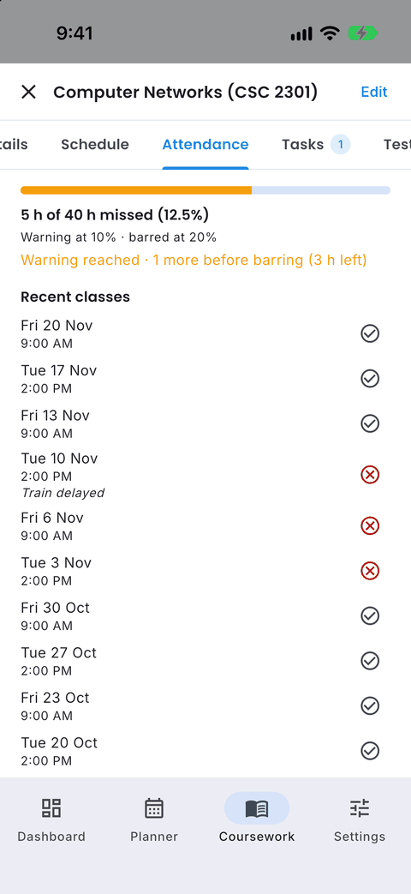
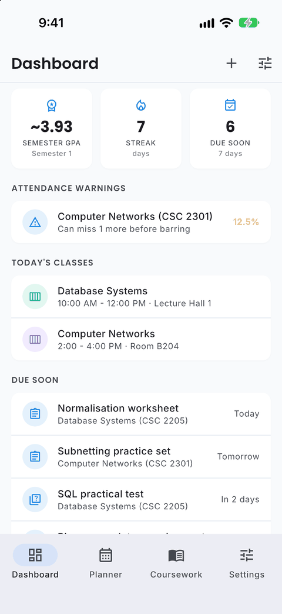
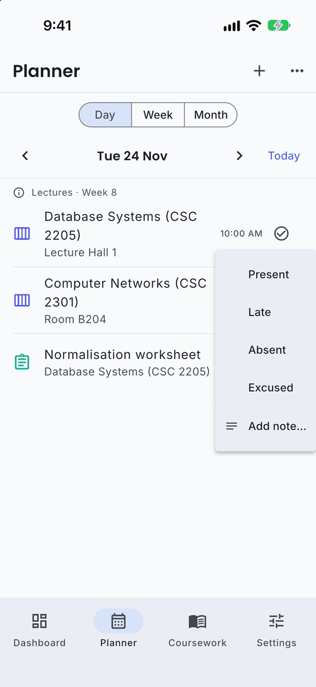
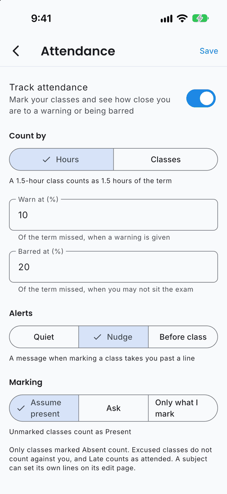

# Attendance

Many universities stop students from sitting a course's final exam when they miss too much of it.
**Attendance** keeps a record of each class you miss and shows, for every subject, how close you are
to a warning or to being barred.

{ width="260" }
{ width="260" }

## How it counts

Only classes you mark **Absent** count as missed.

| Mark | Counts as |
|---|---|
| **Present** | Attended |
| **Late** | Attended, shown as late |
| **Absent** | Missed |
| **Excused** | Not held against you, for example with a medical certificate |

Any mark can carry a short note, such as "MC".

Missed time is measured against the **whole term**: every class of the subject from the first day of
the semester to the last, including the ones still to come. Excused classes stay in that total.
Cancelled classes and holidays are not part of it. A class moved to another day counts on its new
times.

By default it counts **hours**, so a 1.5-hour class is 1.5 hours of the term. You can count
**classes** instead, so that every class counts the same.

## The warning and barring lines

Two lines are set as a percentage of the term:

- **Warn at**: 10% by default;
- **Barred at**: 20% by default.

A line is reached the moment you get to it, not only after you pass it. Numbers are rounded toward
the stricter side, so the app never shows you safer than you are.

A subject can set its own lines. Open the subject, choose **Edit**, and fill in **Warn at %** or
**Barred at %** under **Attendance**. Leave a field empty to use your setting.

## Where to find it

- **The Dashboard** shows an **Attendance warnings** card when a subject you have missed classes in
  is close to a line or past it, worst first: "Can miss 1 more before barring", "Next missed class
  bars you", "Barred". Tap a subject to open its Attendance tab. With nothing close, there is no
  card. You can move or hide it with **Customize dashboard**, like the other cards.
- **A subject's Attendance tab** shows a bar, the hours missed ("3 h of 42 h missed (7.2%)"), both
  lines, and how many more classes you can miss before each. Below it, **Recent classes** lists every
  class held so far, newest first, each with its mark.
- **A class's details** show one line, such as "3 h of 42 h missed". Tap it to open the subject's
  Attendance tab.

## Alerts

Choose how the app warns you in **Settings → Attendance → Alerts**:

- **Quiet**: colours only, no messages.
- **Nudge** (the default): when marking a class takes a subject past a line, a message says so
  straight away, for example "Data Structures (CS201) reached the warning: 10% missed · can miss 3 more
  classes before barring". You also get one when the next missed class would bar you.
- **Before class**: the same, plus a line on the class reminder when missing that class would take
  you past a line, such as "Missing it would reach the warning line (10%)". This needs class
  reminders turned on in **Settings → Reminders**; the Attendance settings say so if they are off.

Nothing appears until you have missed at least one class.

## Marking a class

Each class carries a small icon for its mark: on the Planner beside its time, and on the subject's
Attendance tab.

| Icon | Mark |
|---|---|
| Green tick | **Present** |
| Clock | **Late** |
| Red cross | **Absent** |
| Badge | **Excused** |
| Grey tick | Not marked, counted as present |
| Question mark | Not marked, under **Ask** or **Only what I mark** |
| Empty circle | Still to come |

Tap the icon to choose a mark, add a note, or clear it. You can mark a future class **Absent** or
**Excused** ahead of time, for a trip you already know about.

{ width="260" }

## Marking

Choose how unmarked classes are treated in **Settings → Attendance → Marking**. The numbers are
the same in every mode, because only **Absent** counts as missed.

- **Assume present** (the default): a class you never mark counts as present, and nothing asks you.
- **Ask**: after each class a notification asks how it went, with **Present**, **Absent** and
  **Excused** buttons. A button opens the app and records the mark, with an **Undo**. Classes you
  have not answered show as **Not marked**, and the Dashboard lists the last week's in a **Not
  marked yet** card, where you can mark each one from its icon. These notifications do not need
  class reminders turned on. The web app has no notifications, so there you mark from the card.
- **Only what I mark**: unmarked classes stay **Not marked**, with no prompts. Each subject's
  Attendance tab shows how much you have marked, such as "Marked 18 of 24 past hours".

A class counts as past once it has ended.

## Settings

{ width="260" }

Go to **Settings → Attendance** to:

- turn **Track attendance** off, which hides everything above;
- choose whether to **count by** hours or classes;
- set the **Warn at** and **Barred at** lines;
- choose the **Alerts**: Quiet, Nudge or Before class;
- choose how you **mark**: Assume present, Ask or Only what I mark.

Your marks sync to your other devices and are included in backups.
