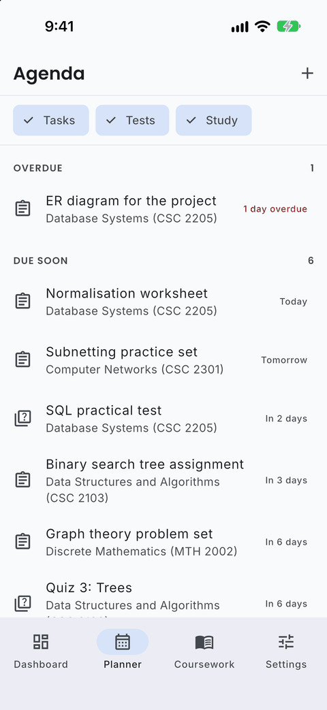
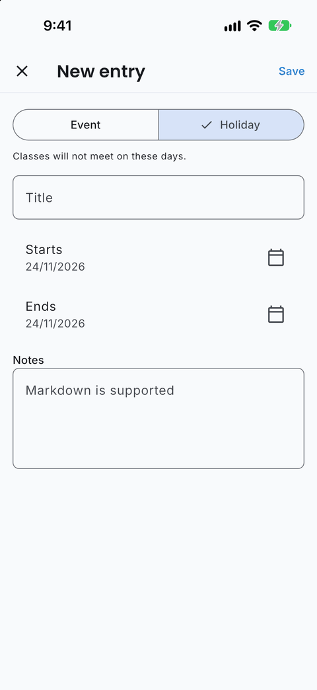

# Agenda, events and holidays

## Agenda

The **Agenda** lists everything that's due, across all your subjects, in three groups: **Overdue**,
**Due soon** and **Later**. It's the quickest way to answer "what do I still have to do?". Find it
under **Planner** on a phone, or in the sidebar on wider screens.

{ width="260" }

- The **Tasks**, **Tests** and **Study** buttons at the top show or hide each kind.
- Each row shows its subject and how long is left, such as **Tomorrow** or **In 3 days**; overdue
  work shows how late it is in red.
- Tap a row to open it. Finished work drops off the list.
- With nothing left, the Agenda says **Nothing outstanding**.

## Events

An event is anything with a date that isn't a class or coursework: a careers fair, a club meeting,
a hackathon weekend.

1. Tap **+** on the Planner, Dashboard or Agenda and choose **Add event**.
2. Enter a **Title** and the **Starts** and **Ends** dates. An event can span several days.
3. Add **Notes** if you like. Notes support Markdown, so you can use lists, bold text and links.
4. Choose **Save**.

Events show in the Planner on their days and along the top of the week view.

## Holidays

A holiday is a day, or several, when **classes will not meet**, such as a public holiday.

{ width="260" }

1. Tap **+** and choose **Add holiday**, or choose **Holiday** at the top of a new entry.
2. Enter a title and its dates, then **Save**.

Classes on those days disappear from the Planner, the Dashboard and your reminders, and don't count
toward [attendance](attendance.md).

!!! tip "Holiday or period?"
    For a single day off, add a holiday. For a stretch of the semester, such as a mid-semester
    break, revision week or the exam weeks, add a **period** to the semester in
    [Academics](academics.md#semesters-and-periods) instead. Periods also renumber the teaching
    weeks and tint those days in the month view.

If you study in one time zone and your university is in another, holidays follow the university's
calendar. See [Time zones](schedule.md#time-zones).

## Google Calendar

To see your classes, tasks and tests in Google Calendar, connect it in
[Settings → Google Calendar](settings.md#google-calendar). Stutastic Planner keeps a calendar of its
own there and updates it as your planner changes. For a one-off file instead, use
[Export to a calendar](schedule.md#export-to-a-calendar).
