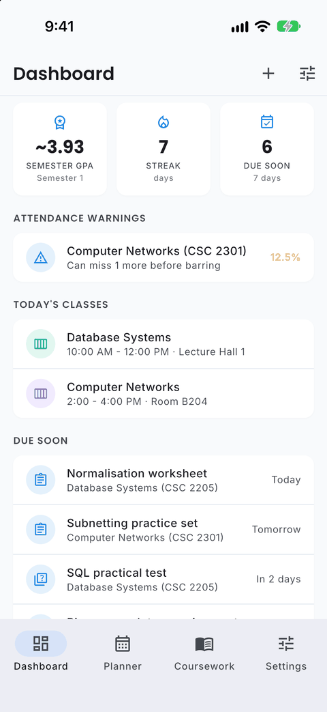
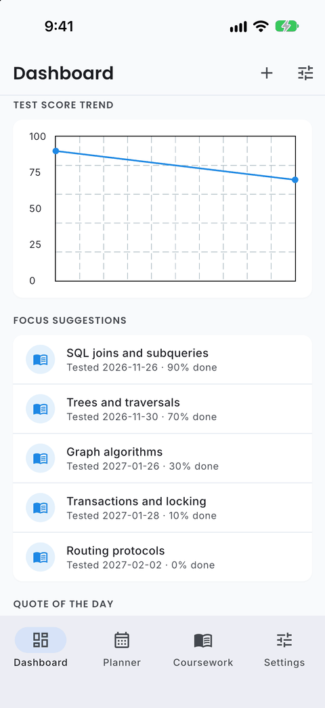
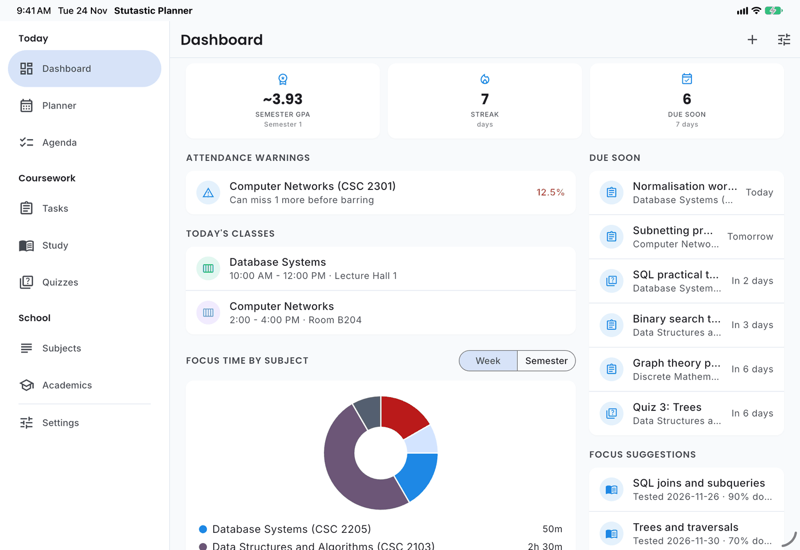
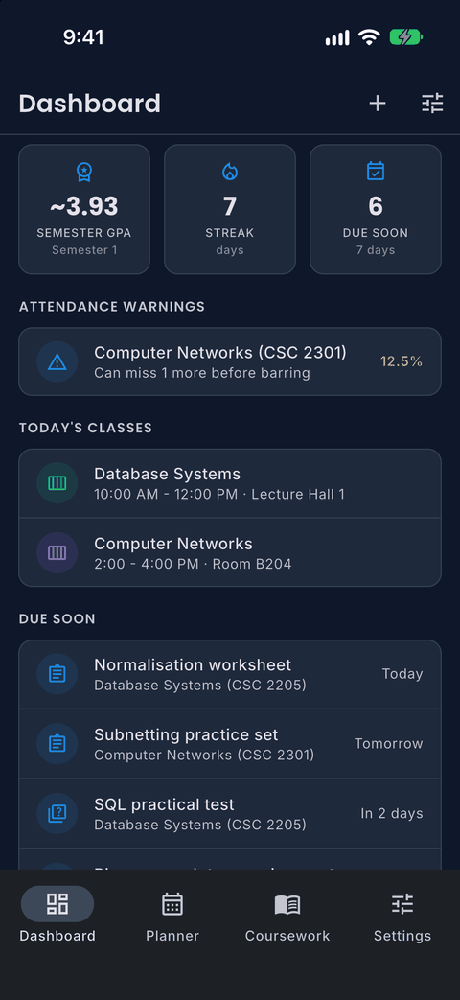

# Dashboard

The **Dashboard** is the first screen you see. It answers "what's on today, and what's coming?" for
your current semester, and gathers the numbers you'd otherwise look up across several screens.

{ width="260" }
{ width="260" }

## The cards

From the top, in their usual order:

| Card | Shows |
|---|---|
| **Stats row** | **Semester GPA** (a `~` in front means some grades are still estimates), your focus **Streak** in days, and how many things are **Due soon** in the next 7 days |
| **Attendance warnings** | Subjects close to the warning or barring line, worst first. Only appears when one is. See [Attendance](attendance.md) |
| **Not marked yet** | The last week's classes waiting for a mark, when you mark attendance with **Ask** |
| **Today's classes** | Today's classes with their times and rooms. Cancelled and moved classes are already accounted for |
| **Due soon** | Tasks and tests coming up, with how long you have left |
| **Focus time by subject** | Where your focus time went, this **Week** or this **Semester** |
| **Test score trend** | Your quiz and test scores over time |
| **Focus suggestions** | Study topics to revise next: those linked to the nearest tests and furthest from done come first |
| **Quote of the day** | Something to read before you start |

Tap any row to open it. Your streak counts days with at least one finished focus block; today not
having one yet doesn't break it.

!!! tip "Nothing on the Dashboard?"
    The Dashboard needs a semester. With none, it shows **No semester yet** and an
    **Add a semester** button. Cards fill in as you use the app: the test trend, for example,
    says **No graded tests yet.** until a test has a score.

## Add from the Dashboard

Tap **+** at the top to add a class, task, test, topic, event or holiday without leaving the screen.

## Customise it

Tap the sliders button at the top right to open **Customize dashboard**. Switch off any card you
don't use, move cards with the up and down arrows, then choose **Save**. **Reset** puts everything
back.

The layout is kept per device, so your phone can show a short list while your computer shows
everything.

## On wider screens

On a tablet in landscape or a large window, the Dashboard uses two columns: your day on the left and
**Due soon** and **Focus suggestions** on the right.

## Dark mode

The Dashboard, like the rest of the app, follows your device's light or dark appearance unless you
choose one in [Settings → Appearance](settings.md#appearance).

{ width="260" }
