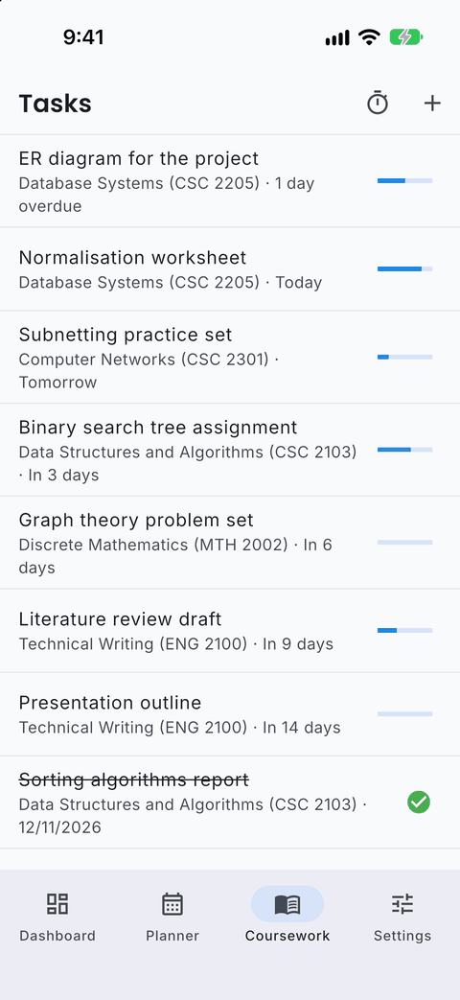
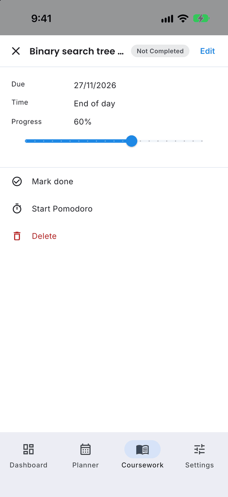
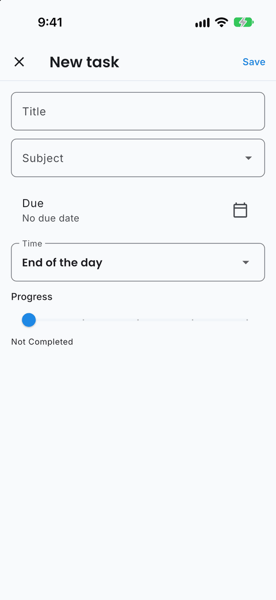
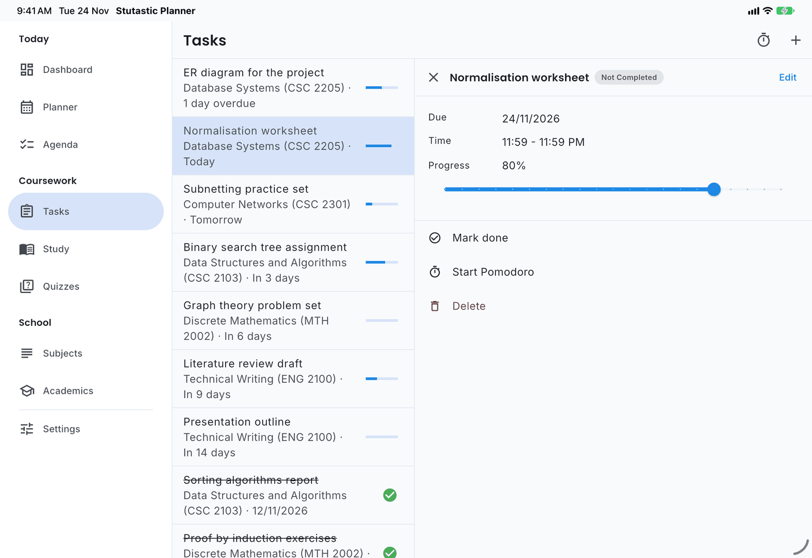

# Tasks

Tasks are your assignments, reports, problem sets and anything else you have to hand in. Each one
belongs to a subject, can have a due date, and has a progress bar you move as you work on it.

{ width="240" }
{ width="240" }
{ width="240" }

## Add a task

1. Open **Tasks** (under **Coursework** on a phone) and tap **+**. You can also add one from the **+**
   on the Planner or Dashboard, or press ⌘N (Ctrl+N).
2. Enter a **Title** and choose the **Subject**.
3. Set **Due** if it has a deadline. Leave it at **No due date** for work without one.
4. **Time** is **End of the day** unless you pick a time, for a submission that closes at 5 PM, for
   example.
5. Choose **Save**.

## The list

Tasks are listed with the soonest due first. Each row shows its subject and how long you have left,
such as **Today**, **Tomorrow**, **In 3 days** or **1 day overdue**. Finished tasks are struck
through with a green tick at the bottom.

On a tablet in landscape or a large window, the selected task opens beside the list.

## Track progress

Open a task and drag its **Progress** slider as you go, in steps of 5%. At 100% the task is
**Completed**. **Mark done** jumps straight there.

Until a task is done, it stays in **Due soon** on the Dashboard and in the [Agenda](calendar.md).

## Work on it

**Start Pomodoro** on a task starts a [focus session](pomodoro.md) on it, and the time you spend is
logged against its subject. The timer button at the top of the Tasks list starts a session where you
can pick several tasks at once.

## Edit or delete

Open the task and choose **Edit** to change it, or **Delete** to remove it. Focus time already logged
against a deleted task is kept in your totals.

On a Mac, right-click a task in the list for **Mark done** and its other actions.

## Reminders

With [reminders](notifications.md) on, the app tells you what's due today before your first class,
and what's due tomorrow after your last one.
