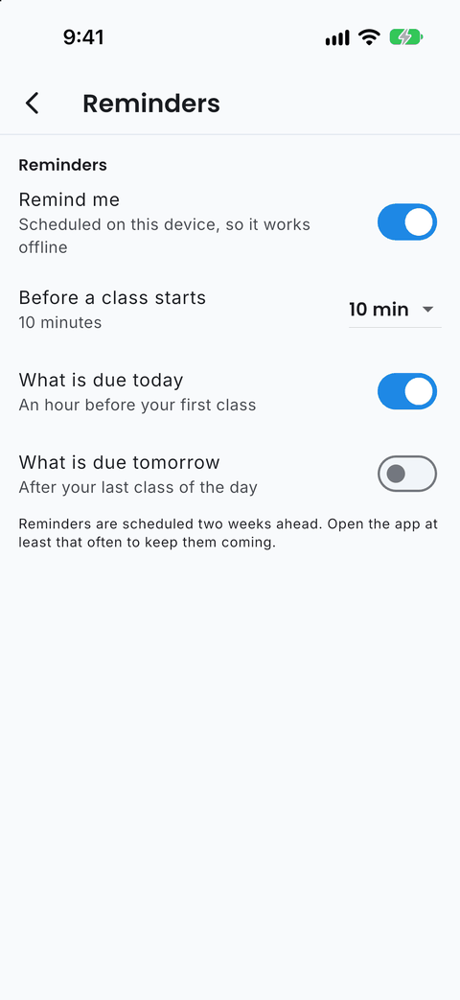

# Reminders

Stutastic Planner can remind you before each class and about what's due. Reminders are scheduled on
your device, so they arrive even when you're offline, and they don't need an account. They're off
until you turn them on.

{ width="260" }

## Turn reminders on

1. Open **Settings → Reminders** and turn on **Remind me**. You can also turn them on during
   [setup](../getting-started/onboarding.md), at **Never miss a class**.
2. Allow notifications when your device asks.

If you said no to notifications earlier, turn them on for Stutastic Planner in your device's
settings, then come back.

## What you're reminded about

| Reminder | When |
|---|---|
| **Before a class starts** | 5, 10, 15, 30 or 60 minutes before each class (10 by default) |
| **What is due today** | An hour before your first class of the day |
| **What is due tomorrow** | After your last class of the day |

Cancelled classes, moved classes and holidays are taken into account. With
[attendance alerts](attendance.md#alerts) set to **Before class**, a class reminder also tells you
when missing that class would take you past a line.

!!! warning "Open the app every two weeks"
    Reminders are scheduled two weeks ahead. Open the app at least that often so it can schedule the
    next two weeks.

Turning **Remind me** off cancels every reminder already scheduled on the device.

## By platform

- **iPhone, iPad, Android, Mac and Windows:** reminders arrive whether or not the app is open.
- **Linux:** reminders arrive only while Planner is running. **Start at login** and
  **Keep running in the tray**, on this page, keep it running in the background; closing the window
  then leaves it in the tray.
- **Web:** reminders aren't available. Use one of the apps, or connect
  [Google Calendar](settings.md#google-calendar) and let it remind you.

Reminders are set per device: turn them on on each device you want them on.
