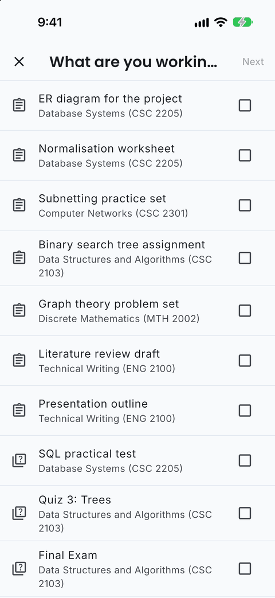
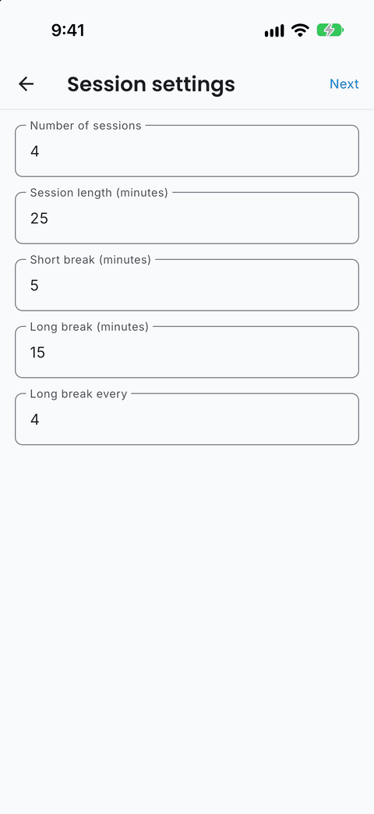
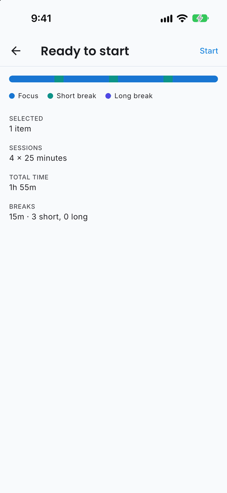
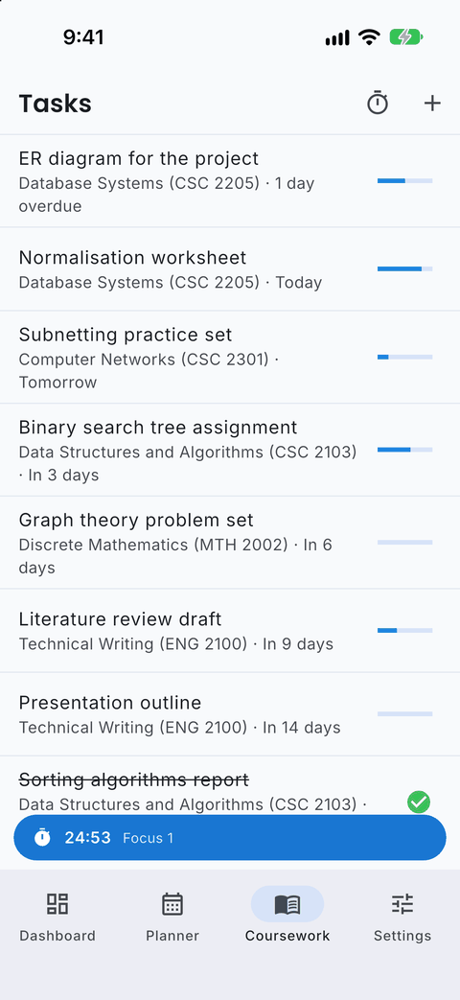
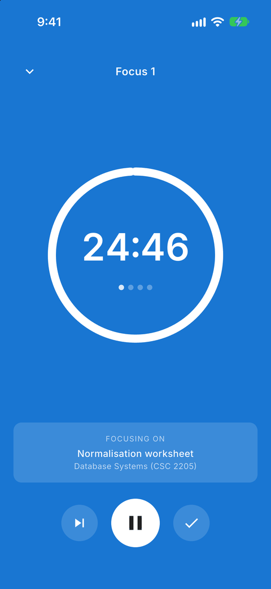
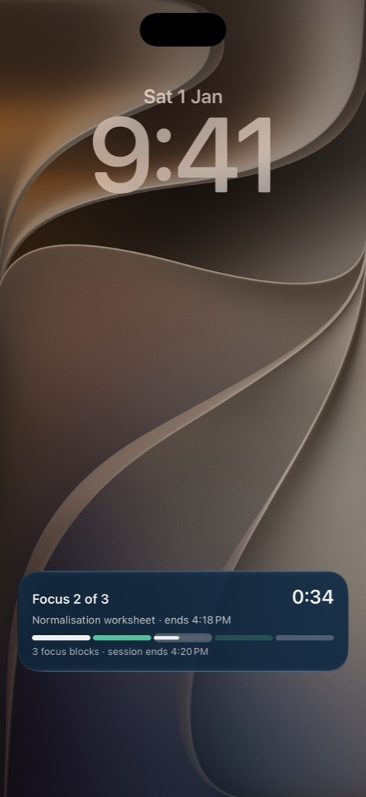
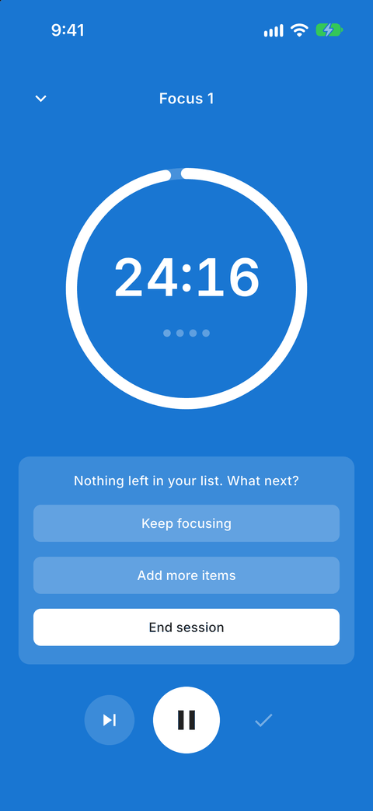

# Focus sessions

A focus session is a Pomodoro timer: blocks of focused work with short breaks between them and a
longer break every few blocks. You choose what you're working on first, so the time is logged
against the right subject and you can tick things off as you finish them.

## Start a session

**On one thing:** open a task, topic or test and choose **Start Pomodoro** (**Focus with
Pomodoro** on a test). The timer starts straight away on it.

**On a list of things:** tap the timer button at the top of **Tasks**, **Study** or **Quizzes**, or
press ⇧⌘F (Ctrl+Shift+F). Then three short steps:

{ width="200" }
{ width="200" }
{ width="200" }

1. **What are you working on?** Tick one or more tasks, tests and study topics, in the order you'll
   do them, then **Next**.
2. **Session settings.** The **Number of sessions**, the **Session length**, the **Short break** and
   **Long break** in minutes, and how often the long break comes (**Long break every**). The defaults
   are 4 × 25 minutes with 5-minute breaks and a 15-minute long break. Then **Next**.
3. **Ready to start.** The whole session as a bar of focus and break blocks, with the total time.
   Choose **Start**.

## While it runs

The timer shows as a bar above the tabs, so you can keep using the app. Tap it to open the full
timer.

{ width="200" }
{ width="200" }
{ width="200" }

The full timer has three buttons:

| Button | Does |
|---|---|
| Skip phase | Ends this focus block or break now and moves to the next |
| Pause / resume | Stops the clock until you resume. Space does the same with a keyboard |
| Finished this one | Marks what you're on as done, and moves to the next thing in your list |

**Finished this one** completes a task and takes a study topic to 100%. A test isn't changed: you've
finished studying for it, not sitting it.

The arrow at the top shrinks the full timer back to the bar.

**Outside the app:**

- **iPhone:** the timer stays on the Lock Screen and in the Dynamic Island. The Lock Screen shows
  the phase, what you're working on and the time left, with the whole session as a bar underneath:
  blocks you've finished are solid, the one you're in fills up as you go, and breaks are green. It
  also says when this block and the whole session end. The card turns green on a break and grey
  while paused.
- **Android:** an ongoing notification shows the phase, the time left and a bar for the whole
  session. On Android 16 and later the bar is split into your focus blocks and breaks.

The timer keeps time even if the app is closed: come back and it's where it should be.

## When your list is done

When you've finished everything you ticked, the app asks **Nothing left in your list. What next?**

{ width="200" }

- **Keep focusing** carries on without an item.
- **Add more items** goes back to the list.
- **End session** stops and saves the session.

## Where the time goes

Every focus block you finish is logged against the subject of what you were working on. It shows on
the [Dashboard](dashboard.md) in **Focus time by subject**, for this week or this semester, and keeps
your **Streak** going.

Focus sessions work offline. Signed in, they sync to your other devices; deleting a task later keeps
the time already logged against it.
