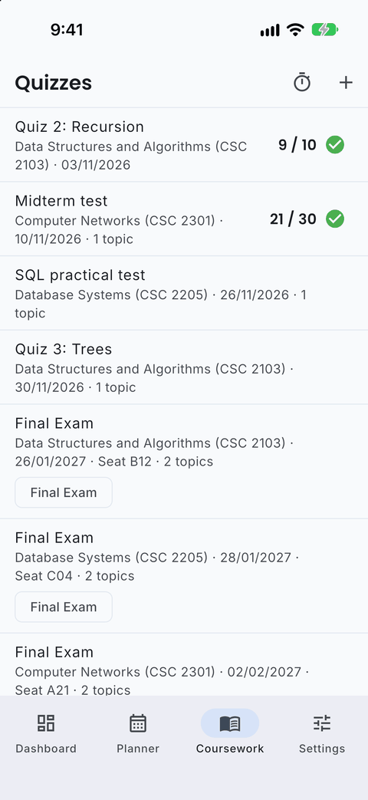
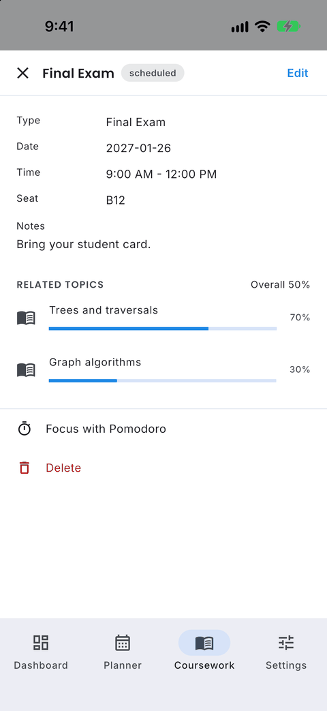

# Quizzes and exams

Keep every quiz, test and final exam in one list, with its date, its seat, the topics it covers and,
afterwards, your score.

{ width="260" }
{ width="260" }

## Add a quiz or test

1. Open **Quizzes** (under **Coursework** on a phone) and tap **+**, or press ⌥⌘Q (Ctrl+Alt+Q).
2. Leave **Quiz or test** selected. Enter a **Title**, such as "Quiz 3: Trees", and choose the
   **Subject**.
3. Set the **Date**, and a start and end time if you know them. Pick a start time and the end is
   filled in from your default class length.
4. Under **Topics covered**, tick the [study topics](study.md) it tests. Only the subject's own
   topics are listed.
5. Choose **Save**.

Once it's graded, open it, choose **Edit**, and enter the **Score** and what it's **Out of**. Scores
feed the Dashboard's **Test score trend** and, if you give the subject
[marks categories](academics.md#marks-and-grades), its grade.

!!! tip "No need to close it yourself"
    Once a quiz's date has passed, it shows as completed, with or without a score. Add the score
    whenever it comes back.

## Add a final exam

Choose **Final Exam** at the top of the form. It adds:

- **Seat or table number**, shown in the list and the details, so you know where to go on the day;
- a default end time from your **default exam length**, which you set in
  [Settings → Class and exam lengths](settings.md#class-and-exam-lengths).

A final exam's score isn't typed in. It's worked back from the subject's final grade once you set
it under [Subjects](academics.md#marks-and-grades).

Add a **Notes** line for anything you'll need on the day, such as "Bring your student card".

## Before the test

Open a test to see its **Related topics**, each with its progress, and an **Overall** figure for how
ready you are. **Focus with Pomodoro** starts a [focus session](pomodoro.md) on it.

The nearest tests also drive the Dashboard's **Focus suggestions**, which list the linked topics
you're least ready for first.

## Time zones

If your programme has its own time zone (see
[Programmes](academics.md#programmes)), a test's date and time are entered in that time zone and shown
in the time zone you're in. Most people never need this.
