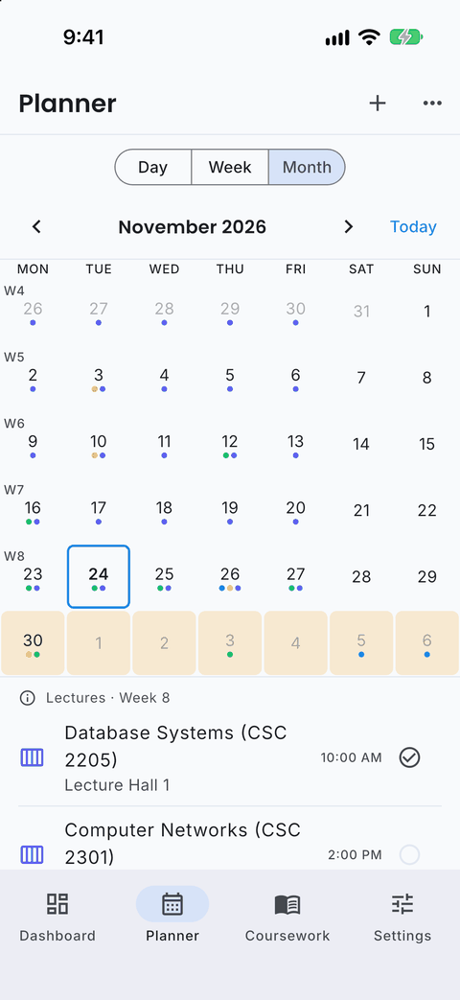
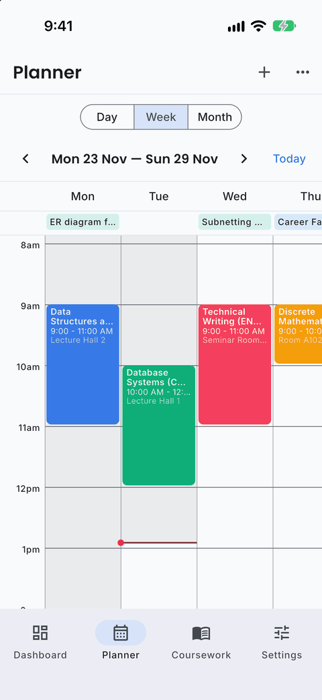
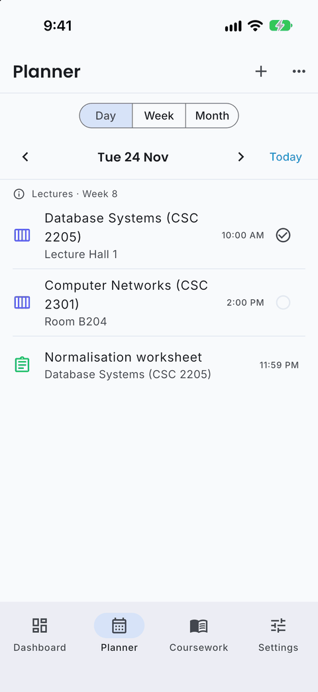
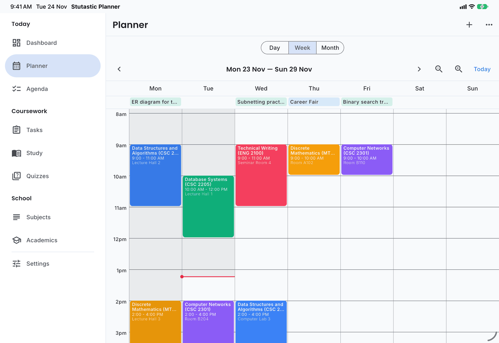
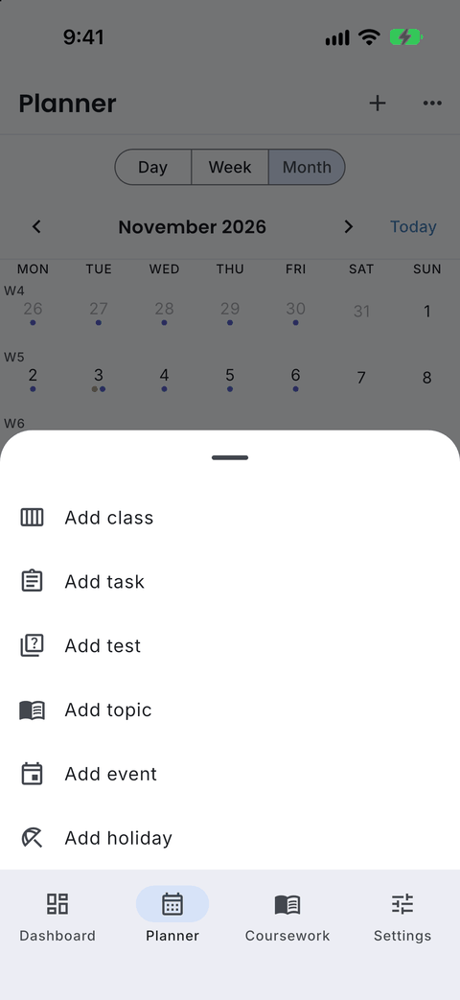
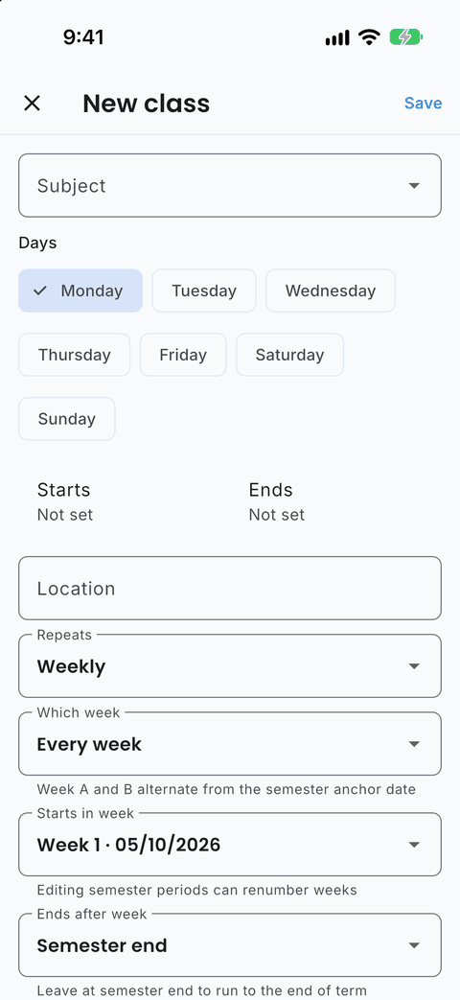
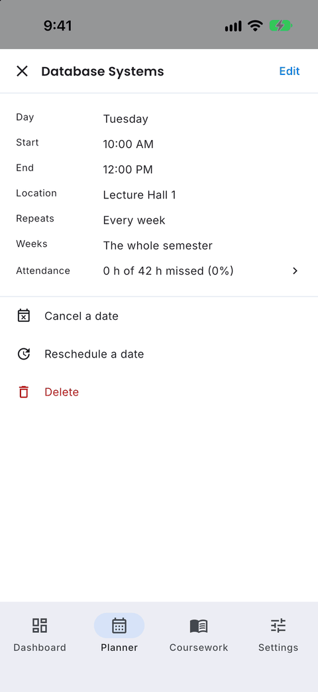
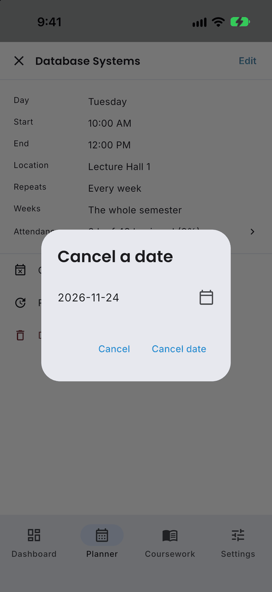
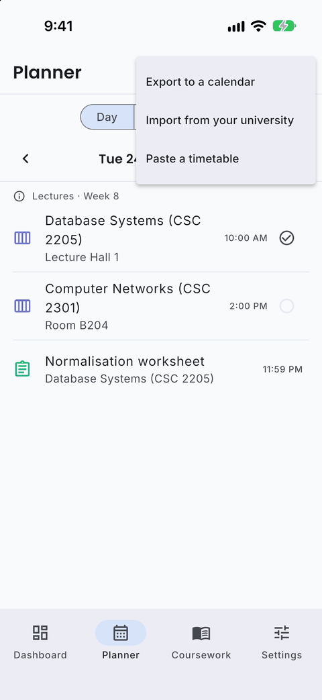
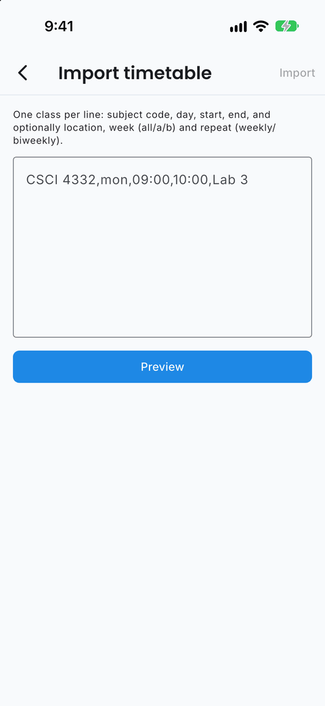

# Planner

The **Planner** is your timetable and calendar in one. It shows your classes for the semester,
together with tasks, tests, events and holidays, by **Day**, **Week** or **Month**.

{ width="240" }
{ width="240" }
{ width="240" }

## Move around

- Switch between **Day**, **Week** and **Month** at the top.
- Use the arrows to go back or forward, and **Today** to come back.
- **Month** numbers each teaching week (W1, W2 …) and tints days that fall in a break, revision or
  exam period. Tap a day to list its items underneath, with the period and week, such as
  "Lectures · Week 8".
- **Week** puts deadlines along the top and classes in the grid. A red line marks the time now. The
  magnifier buttons zoom the hours in and out.
- Tap any class or item to open it.

On a tablet in landscape or a large window, the week view shows all seven days at once.



## Add a class

Tap **+** and choose **Add class**. The same menu adds a task, test, study topic, event or holiday.

{ width="240" }
{ width="240" }

1. Choose the **Subject**. Add the subject first in [Subjects](academics.md#subjects) if it isn't
   there.
2. Tick one or more **Days**. A class on Monday and Wednesday at the same time is one class.
3. Set **Starts** and **Ends**, and an optional **Location**.
4. Under **Repeats**, choose **Weekly**, or **Every 2 weeks** for a class that alternates. See
   [Alternating weeks](#alternating-weeks).
5. **Starts in week** and **Ends after week** limit a class to part of the term, such as a lab that
   begins in Week 3. Leave **Ends after week** at **Semester end** to run to the end of term.
6. Choose **Save**.

When you pick a start time first, the end time is filled in from your default class length in
[Settings → Class and exam lengths](settings.md#class-and-exam-lengths). Change it if this class runs
longer.

## Class details

Tap a class to see its day, times, location, how it repeats and which weeks it runs. If you track
[attendance](attendance.md), a line such as "0 h of 42 h missed (0%)" shows how much of the subject
you've missed; tap it to open the subject's Attendance tab.

{ width="240" }
{ width="240" }

### Cancel or move one date

Classes get cancelled and moved. Change one date without touching the rest of the term:

- **Cancel a date** removes the class on one date. The date you opened the class from is filled in;
  choose another if you need to.
- **Reschedule a date** moves one date to another day and time: pick the date, then where it's
  **Moved to**, with its **Start** and **End**.

The change shows everywhere: the Planner, the Dashboard, reminders, attendance and Google Calendar.
To cancel classes for a public holiday across all your subjects, add a
[holiday](calendar.md#holidays) instead.

**Edit** changes the class for the whole term. **Delete** removes the class after asking.

## Alternating weeks

For a class that meets every other week:

1. Open the semester in **Academics**, choose **Edit**, and on **Periods** set the Week A anchor date:
   the first day of a Week A.
2. Add or edit the class, set **Repeats** to **Every 2 weeks**, and choose **Which week**:
   **Week A** or **Week B**.

Weeks A and B then alternate from that date.

## Bring in a timetable

The **⋯** menu at the top of the Planner has three ways to add classes in bulk, and one way out:

{ width="240" }
{ width="240" }

### Import from your university

Signs in to your student portal and brings in your subjects and classes. See
[Import from your university](university-import.md).

### Paste a timetable

Type or paste one class per line: the subject code, the day, the start and end times, and optionally
the location, the week (`all`, `a` or `b`) and how it repeats (`weekly` or `biweekly`). For example:

```text
CSC 2103,mon,09:00,11:00,Lecture Hall 2
CSC 2103,wed,14:00,16:00,Computer Lab 3
CSC 2301,fri,09:00,10:00,Room B210,a,biweekly
```

Choose **Preview** to check the rows, match each code to a subject, then **Import**.

### Export to a calendar

Saves an `.ics` file of the semester's classes. Open it in Apple Calendar, Google Calendar, Outlook or
any calendar app that reads iCalendar files. It's a one-off copy; for a calendar that stays up to
date, connect [Google Calendar](settings.md#google-calendar).

## Time zones

Classes use the time zone set for their programme. If the programme has no time zone set, your
device's time zone is used. When you travel, times are shown in the time zone you're in.

A class from another time zone can land on a different day for you. A Monday morning class in
Kuala Lumpur, for example, happens on Sunday evening in New York. Holidays, term dates and
teaching weeks still follow the university's own calendar, so that class is off when the
university's Monday is a holiday, whatever the date where you are. Cancelling or moving one
class uses the day it shows on in your Planner.
