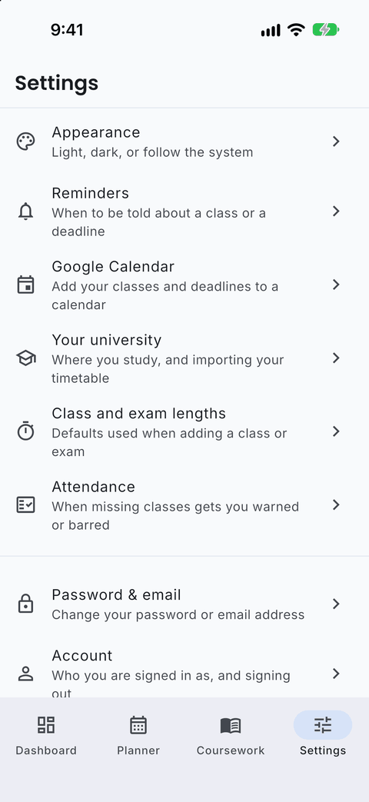
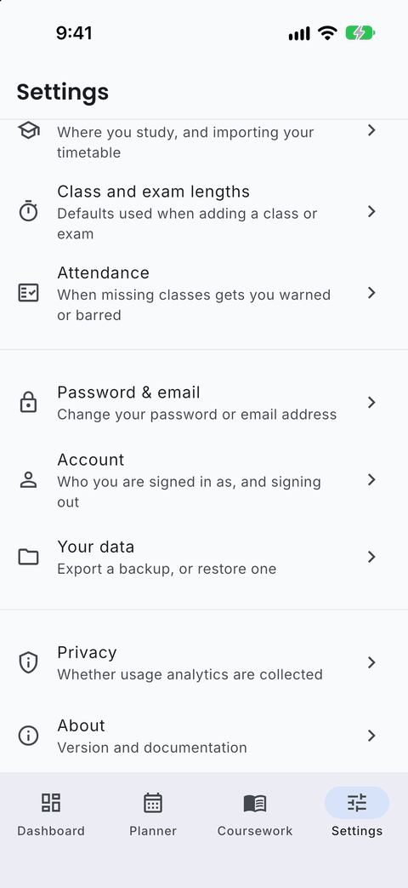
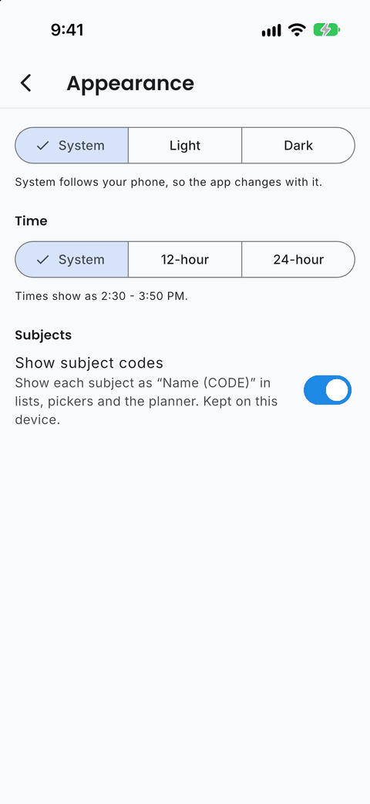
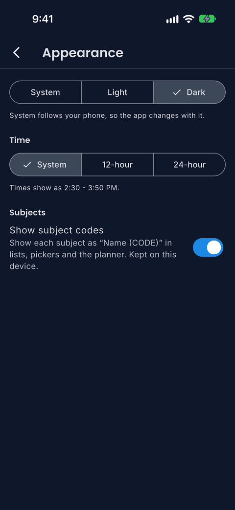
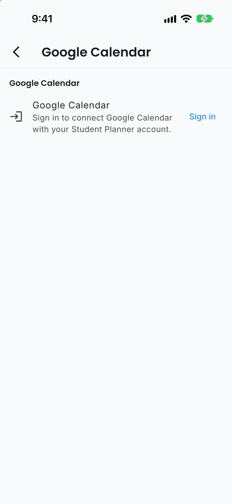

# Settings

Settings is a list of pages. On a phone, tap a row to open it. On a tablet in landscape or a large
window, the page opens beside the list.

{ width="240" }
{ width="240" }

| Page | What it's for |
|---|---|
| [Appearance](#appearance) | Light or dark, the clock, and subject codes |
| [Reminders](#reminders) | Class and deadline reminders on this device |
| [Google Calendar](#google-calendar) | A calendar in your Google account that follows your planner |
| [Your university](#your-university) | Where you study, timetable import, and kept logins |
| [Class and exam lengths](#class-and-exam-lengths) | Default lengths and named exam start times |
| [Attendance](attendance.md#settings) | Tracking, the warning and barring lines, alerts and marking |
| [Password & email](#password-email) | Your sign-in details |
| [Account](#account) | Sync status, sign out, or delete your account |
| [Your data](#your-data) | Export a backup or restore one |
| [Privacy](#privacy) | Usage analytics |
| [About](#about) | Version, this site, support and updates |

## Appearance

{ width="240" }
{ width="240" }

- **System**, **Light** or **Dark**. **System** follows your device, so the app changes with it.
- **Time**: **System**, **12-hour** or **24-hour**. The line underneath shows how times will look,
  such as "2:30 – 3:50 PM".
- **Show subject codes**: show each subject as "Name (CODE)" in lists, pickers and the Planner.
  Turn it off for names only.

These are kept on this device, so your phone and computer can differ.

## Reminders

Turn on **Remind me**, then choose what you're reminded about. See [Reminders](notifications.md).

## Google Calendar

Google Calendar is optional and needs a Stutastic Planner account. A guest sees **Sign in** here
first.

{ width="240" }

1. Open **Settings → Google Calendar** and choose **Connect Google Calendar**.
2. Sign in to Google and allow access.

Planner then creates a calendar of its own in your Google account and keeps your classes, tasks and
tests in it as your planner changes. It never touches your other calendars.
**Let Google Calendar remind me too** adds Google's own reminders to those events. It's off by
default; turn it on if you'd like Google to remind you as well as the app.

**Disconnect** stops the connection and asks Google to remove the Planner calendar. Deleting your
account disconnects it too. If the app can't confirm the calendar was removed, account deletion stops
so you can try again. Google may sometimes leave the calendar behind; you can then delete it in
Google Calendar yourself.

!!! tip "On Apple devices: \"no authorisation code\""
    If connecting fails with this message, Google already has Stutastic Planner listed from an
    earlier connection. Remove Stutastic Planner from your Google account's third-party access, then
    connect again.

## Your university

Where you study and what the app does for it: **Import timetable**, changing university, and the
semesters kept up to date with your portal, with **Refresh now** and **Forget my login**. Keeping a
login isn't available on the web. See [Import from your university](university-import.md).

## Class and exam lengths

- **Default class length (minutes)** fills in a class's or a quiz's end time when you pick its start.
- **Default exam length (minutes)** does the same for a final exam.
- **Exam sessions** are named start times, such as "Morning, 9:00 AM", to pick from when you schedule
  an exam. Choose **Add** to add one.

## Password & email

Change the password or email address you sign in with.

## Account

- **As a guest:** **Create an account to sync** keeps everything you have and starts syncing it.
  **Leave without saving** deletes the guest data on this device, after asking.
- **Signed in:** shows whether your changes have synced. **Sign out** keeps your account and clears
  this device. **Delete my account** removes the account and its synced data.

If the server ever refuses a change, **Changes that couldn't be saved** appears here with a
**Review** button. Each change can be tried again or discarded; nothing is lost until you discard it.

Leaving, signing out and deleting all leave the device as if the app had just been installed. See
[Guest mode vs. an account](../getting-started/guest-vs-account.md).

## Your data

**Export everything** saves a backup file. **Restore from a backup** loads one, merged with what you
have or replacing it. See [Export and import](../data/export-import.md).

## Privacy

**Usage analytics** turns anonymous usage statistics on or off for this device. See the
[Privacy Policy](../data/privacy-policy.md).

## About

The installed **Version**, a link to this **Documentation**, and **Support** for searching issues or
reporting a bug. On Windows and Linux, **Check for updates** looks for a newer version; other
platforms update from their app store. The app also tells you when a new version is ready.
