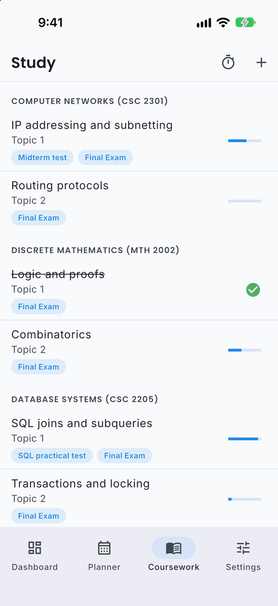
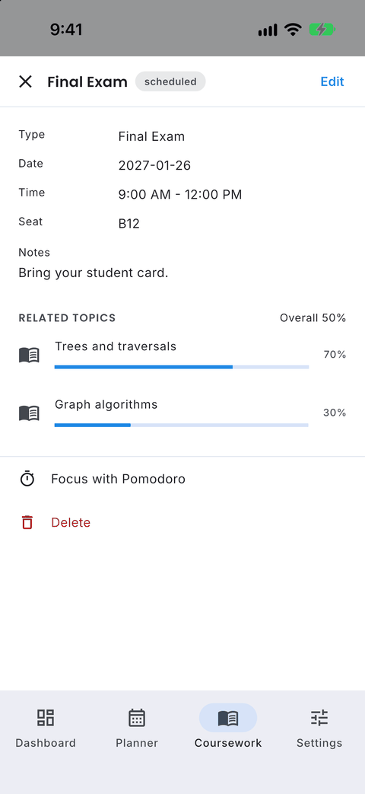

# Study topics

Study topics break a subject into the chapters or topics you need to revise, so you can see how ready
you are for each test. Tasks are for work you hand in; topics are for what you need to know.

{ width="260" }

## Add a topic

1. Open **Study** (under **Coursework** on a phone) and tap **+**, or press ⌥⌘S (Ctrl+Alt+S).
2. Enter the **Topic** and choose the **Subject**.
3. **Topic number** keeps topics in the order you'll study them, such as the lecture or chapter
   number.
4. **Revise by** is an optional date of your own, such as the night before the test.
5. Set **Progress** if you've already started, then **Save**.

## The list

Topics are grouped by subject. Each row shows its topic number, a progress bar, and a chip for every
test it's linked to, such as **Midterm test** or **Final Exam**. Finished topics are struck through
with a green tick.

Open a topic and drag its progress as you revise. At 100% it's done.

## Link topics to tests

When you add or edit a [quiz, test or final exam](quiz.md), tick the subject's topics under
**Topics covered**. Then:

- the topic shows that test's chip in the Study list;
- the test shows its topics and an overall progress, so you can see how ready you are;
- the Dashboard's **Focus suggestions** puts the topics for your nearest tests that are furthest from
  done at the top.

{ width="260" }

## Revise with focus sessions

Start a [focus session](pomodoro.md) on a topic, from the timer button at the top of **Study** or the
topic's own details. The time counts toward the subject in your focus summaries.
