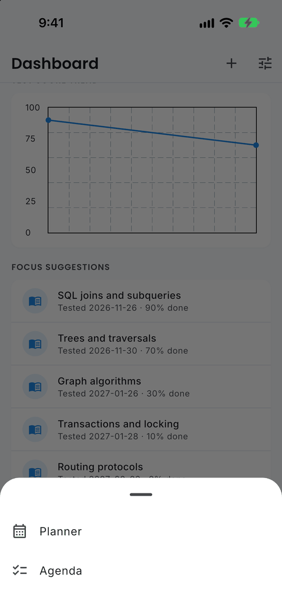
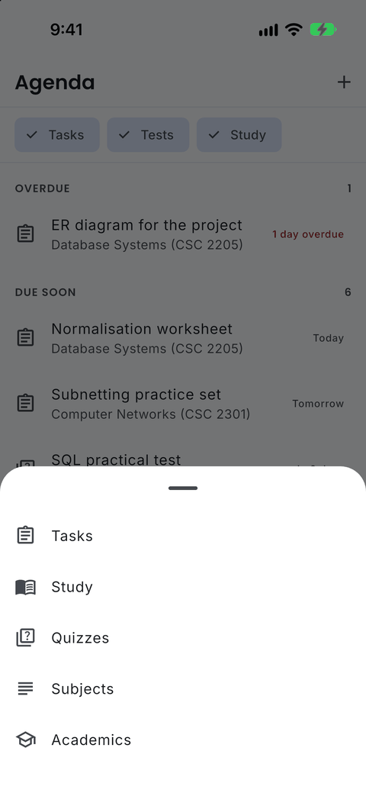
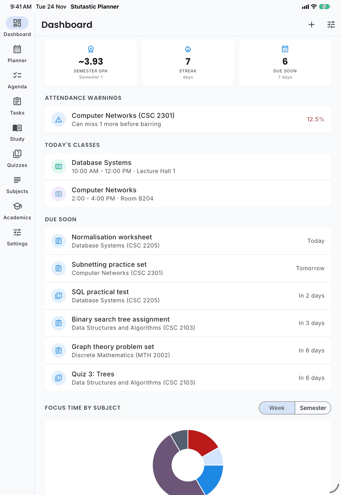
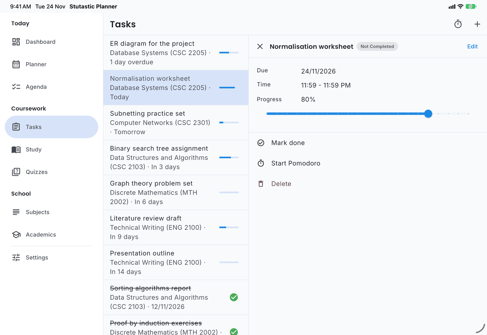

# Getting around

Stutastic Planner has nine screens. The layout changes with the width of the screen or window, but
the screens are the same everywhere:

| Screen | What it's for |
|---|---|
| **Dashboard** | Today's classes, what's due, attendance warnings and your study summaries |
| **Planner** | Your timetable and calendar by day, week or month |
| **Agenda** | Everything due, overdue first, in one list |
| **Tasks** | Assignments and other work with a due date |
| **Study** | Revision topics, grouped by subject |
| **Quizzes** | Quizzes, tests and final exams |
| **Subjects** | Each subject's details, schedule, attendance, work and grades |
| **Academics** | Programmes, years, semesters, GPA and CGPA |
| **Settings** | Preferences, reminders, account and backups |

## On a phone

The bar at the bottom has four buttons: **Dashboard**, **Planner**, **Coursework** and
**Settings**. **Planner** and **Coursework** hold more than one screen. Tap one to choose:

- **Planner** → Planner or Agenda;
- **Coursework** → Tasks, Study, Quizzes, Subjects or Academics.

{ width="260" }
{ width="260" }

Tap **+** at the top of a screen to add something, and tap a row to open its details.

## On a tablet or a wider window

On an iPad, an Android tablet, or a desktop window of medium width, every screen has its own button
in a rail down the left side.

{ width="420" }

On wider screens, such as an iPad in landscape or a large desktop window, the rail opens out into a
labelled sidebar in three groups: **Today** (Dashboard, Planner, Agenda), **Coursework** (Tasks,
Study, Quizzes) and **School** (Subjects, Academics).

Lists also show the selected item beside them, so you can go down a list without opening and closing
each one. **Nothing selected** shows until you pick a row.

## Keyboard shortcuts

With a keyboard attached (a Mac, Windows or Linux computer, an iPad or Android tablet with a
keyboard, or the web app), these shortcuts work anywhere in the app. On a Mac, an iPad, or the web app
on a Mac, use the first column; on Windows, Linux and Android, use the second.

| Action | Mac and iPad | Windows, Linux and Android |
|---|---|---|
| New task | ⌘N | Ctrl+N |
| New event | ⇧⌘N | Ctrl+Shift+N |
| New class | ⌥⌘C | Ctrl+Alt+C |
| New quiz | ⌥⌘Q | Ctrl+Alt+Q |
| New study topic | ⌥⌘S | Ctrl+Alt+S |
| Go to a screen, in the order of the table above | ⌘1 to ⌘9 | Ctrl+1 to Ctrl+9 |
| Planner: day, week or month view | ⌃⌘1, ⌃⌘2, ⌃⌘3 | Alt+1, Alt+2, Alt+3 |
| Planner: today | ⌘T | Ctrl+T |
| Planner: previous or next | ⌘[ and ⌘] | Ctrl+[ and Ctrl+] |
| Back | ⌘← | Ctrl+← |
| Settings | ⌘, | Ctrl+, |
| Start a focus session | ⇧⌘F | Ctrl+Shift+F |
| Pause or resume the focus timer | Space | Space |
| Skip to the next focus phase | ⌥⌘→ | Ctrl+Alt+→ |
| Finish the item you're focusing on | ⌥⌘↩ | Ctrl+Alt+Enter |

In a list with its details beside it, **↑** and **↓** move the selection, **Return** (Enter) opens
the selected item for editing, and **Delete** (Backspace) deletes it after asking.

The "new" shortcuts need a semester to add to. Shortcuts never take over while you're typing in a
field.

## On a Mac

The Mac app has a full menu bar with the same commands: **File** for adding items and
**Import Timetable…**, **View** for screens and Planner views, **Go** for moving through the
Planner, **Focus** for the timer, and **Help**, which opens this site. Right-click a row in a list
for its actions, such as **Mark done** on a task.

## On Linux

Planner keeps running in the system tray when you close its window, so reminders still arrive. Click
the tray icon to bring the window back, or right-click it for its menu. Two switches in
**Settings → Reminders** control this: **Start at login** and **Keep running in the tray**.
Reminders arrive only while Planner is running.
