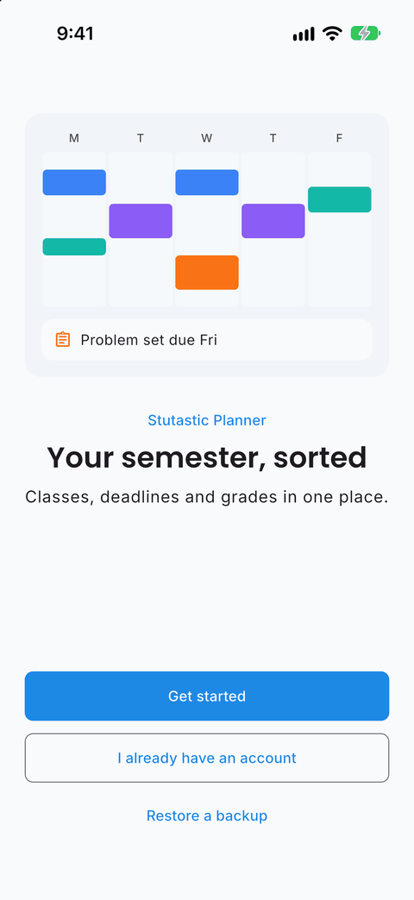
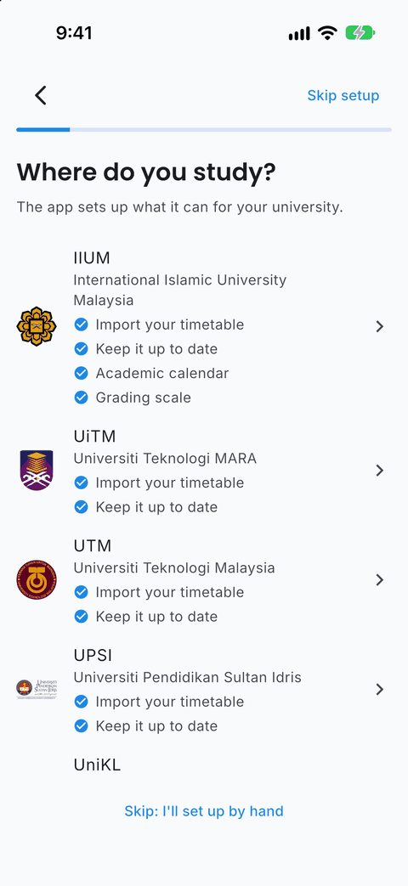
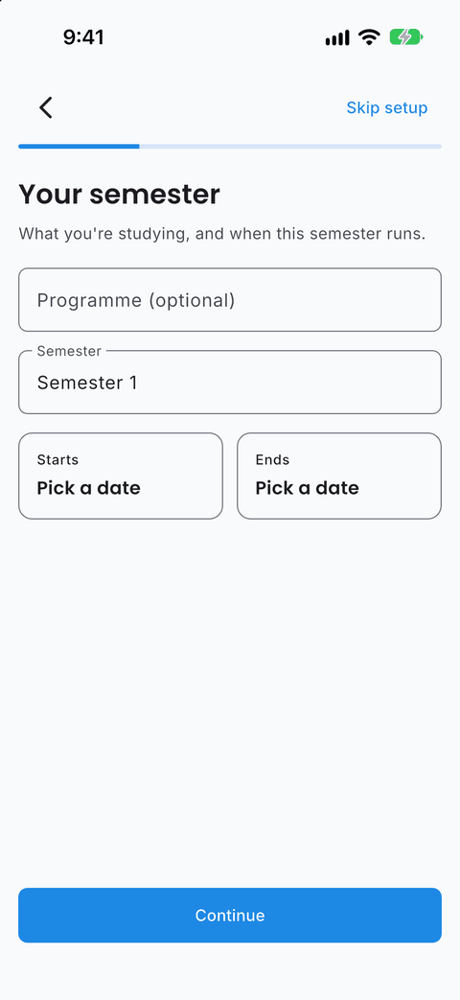
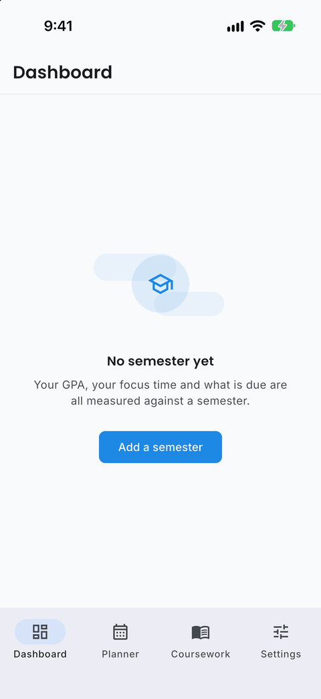

# First-run setup

The first time you open Stutastic Planner, it walks you through your semester in a few short steps.
Every step can be skipped, and anything you leave out can be added later.

{ width="260" }

The welcome screen offers three ways in:

- **Get started** runs the setup below.
- **I already have an account** signs you in. Your planner comes down from your account, so you
  don't need to set anything up again.
- **Restore a backup** loads a backup file you exported earlier, from this app or from the old web
  app, and lets you skip setup. See [Export and import](../data/export-import.md#restore-on-a-new-device).

## The setup steps

{ width="260" }
{ width="260" }

1. **Where do you study?** Choosing your university is optional. Each supported university shows
   what the app can do for it, such as **Import your timetable**, **Keep it up to date**,
   **Academic calendar** and **Grading scale**. Choose **Skip: I'll set up by hand** if yours isn't
   listed. Outside Malaysia, setup opens with **Let's set up your semester** and a **Start** button
   instead; **Is your university supported? See the list** shows the list if you want it.
2. **Bring in your timetable.** For a university whose timetable can be imported, sign in to its
   student portal and your subjects and classes come with you. Choose **Not now** to skip. See
   [Import from your university](../features/university-import.md).
3. **Your semester.** Enter a semester name and its start and end dates. A programme name is
   optional. If your university publishes its academic calendar (IIUM does), pick the semester from
   it instead: its dates and periods (lectures, mid-semester break, revision, exams) are filled in
   for you. **Type my own** brings back the date fields.
4. **Your subjects.** Add the subjects you're taking. Credits are optional. Subjects from your portal
   are listed ticked; untick any you don't want. **Add subjects later** skips the step.
5. **Your timetable.** **Add a class** or **Paste a timetable** (one class per line, see
   [Paste a timetable](../features/schedule.md#paste-a-timetable)). Classes from your portal are
   already here.
6. **Never miss a class.** Choose **Turn on reminders** to get class and deadline reminders on this
   device. Skipped on the web, and when reminders are already on.
7. **Your week is ready.** A summary of the classes and subjects you added.
8. **Keep your semester safe.** Create an account to sync across devices (Google, email, or Apple on
   Apple devices), or choose **Not now, keep it on this device** to carry on as a guest. See
   [Guest mode vs. an account](guest-vs-account.md).

Nothing from your portal is saved until you continue from **Your subjects**.

## Skip setup

**Skip setup**, at the top of every step, takes you straight to the app as a guest. The Dashboard
then shows **No semester yet** with an **Add a semester** button, and everything else can be added
from the app.

{ width="260" }

## What next

- Learn the layout in [Getting around](navigation.md).
- Add the rest of your classes in the [Planner](../features/schedule.md).
- Add assignments in [Tasks](../features/homework.md) and test dates in
  [Quizzes and exams](../features/quiz.md).
- Turn on [Reminders](../features/notifications.md) if you skipped them.
