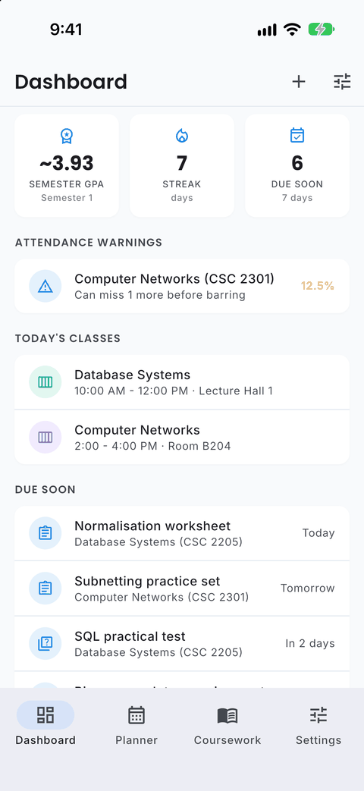
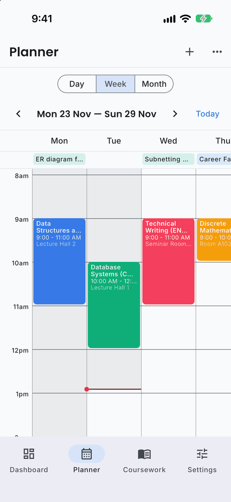
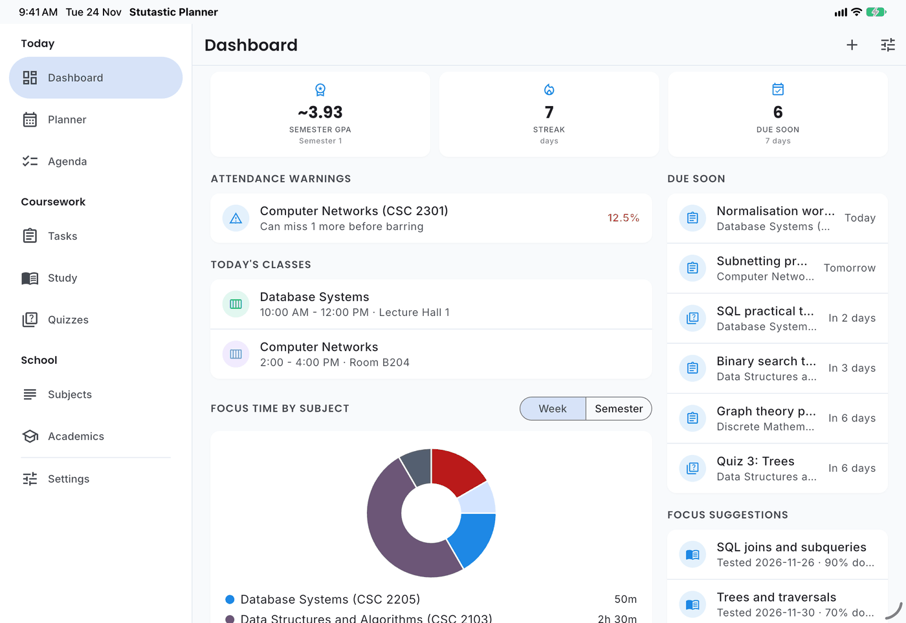

# Stutastic Planner

**Stutastic Planner** keeps your semester in one place: your timetable, assignments, tests, revision,
grades, attendance and focus time. It works offline, on your device first. Sign in if you want it
synced across your phone, tablet, computer and the web.

{ width="260" }
{ width="260" }

## New here?

1. **[Set up your semester](getting-started/onboarding.md).** A few short steps: your university,
   your semester's dates, your subjects and your classes. If your university is supported, your
   timetable can come straight from its student portal.
2. **[Learn your way around](getting-started/navigation.md).** Where everything is on a phone, a
   tablet and a computer, plus keyboard shortcuts.
3. **Decide about an account.** You don't need one. See
   [Guest mode vs. an account](getting-started/guest-vs-account.md).

## Common tasks

| I want to… | Go to |
|---|---|
| Add a class, or cancel or move one date of it | [Planner](features/schedule.md) |
| Bring my timetable in from my university | [Import from your university](features/university-import.md) |
| Track an assignment and how far along it is | [Tasks](features/homework.md) |
| Plan revision for a test | [Study topics](features/study.md) and [Quizzes and exams](features/quiz.md) |
| Record marks and see my GPA | [Subjects and academics](features/academics.md) |
| Know how many more classes I can miss | [Attendance](features/attendance.md) |
| Study in focused blocks | [Focus sessions](features/pomodoro.md) |
| Get reminded before class and about deadlines | [Reminders](features/notifications.md) |
| Mark a public holiday or add an event | [Agenda, events and holidays](features/calendar.md) |
| Keep a copy of everything, or move to a new device | [Export and import](data/export-import.md) |

## Where it runs

iPhone and iPad, Android, Mac, Windows, Linux and the web. Most screens are the same everywhere;
reminders, the Lock Screen timer and the tray differ by platform. See
[System requirements](getting-started/system-requirements.md) and the
[feature overview](features/index.md).

## Help

Check the [FAQ](faq.md), or [contact support](support.md). Read the
[Privacy Policy](data/privacy-policy.md) for what the app collects.
